# 自分用PCセットアップ関連メモ

!!! warning "注意事項"
    本メモの内容に起因して生じた、あらゆる損害や障害について一切の責任を負わない。

## 環境

- Windows 11 26H2
  - Home (Build 26300.9711)
  - Pro（インストールメディアは Build 26300.9457）

## クリーンインストールをする前に…

[初期化前に行う作業](before-reset.md) を必ず確認し実施。

## インストールメディアの作成

Windows のクリーンインストールにあたり、インストールメディア（USB メモリ）を作成しておくと良い。  
（回復オプションからリセットできるが、パーティション全部消して入れ直した方が綺麗になると思っている）

Microsoft の [Windows 11 をダウンロードする](https://www.microsoft.com/ja-jp/software-download/windows11) にアクセスし、`Windows 11 のインストールメディアを作成する` からツールをダウンロード。  
ダウンロードしたメディア作成ツールを実行して、インストールメディアを作成する。

## BIOS/UEFI の設定

参考: https://michisugara.jp/csm_secureboot

Windows 11 の要件は、UEFI ファームウェア（Secure Boot に対応していること）と TPM 2.0。Secure Boot の有効化そのものは要件ではなく推奨。BIOS（UEFI）の設定がわかりにくいので、一応メモ。

- CSM を無効にする（Windows 7 以下が実行不可になる）
- Secure Boot を有効にする（起動時にデジタル署名をチェックする）
- 間違っても両方を有効にはしない
- ASUS のマザーボードなら起動設定（Boot）にある

!!! note "Secure Boot 証明書の更新"
    2011 年に発行された Secure Boot の証明書は、2026 年 6 月から順に失効している。Windows Production PCA 2011 は 2026 年 10 月 19 日に失効した。

## インストール

参考: https://www.ask-corp.jp/guide/pc-diy-part4.html

PCを起動する前に、Windows をインストールしたいストレージ以外のケーブルを外しておく。  
パーティションを削除するときにどのパーティションかわからなくなるので、絶対に外しておくのが吉。

BIOS/UEFI に入り、起動順を変えてインストールメディアとして作成した USB メモリで起動する。Windows 11 のインストーラーが起動するはず。  
インストーラーが起動したら、以下の手順でインストールする。

1. `言語設定を選択` と `キーボード設定を選択` を確認して進む

    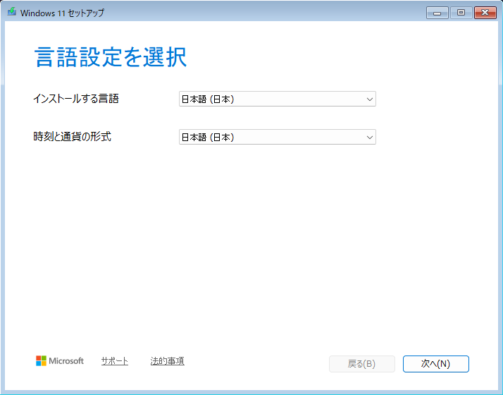

    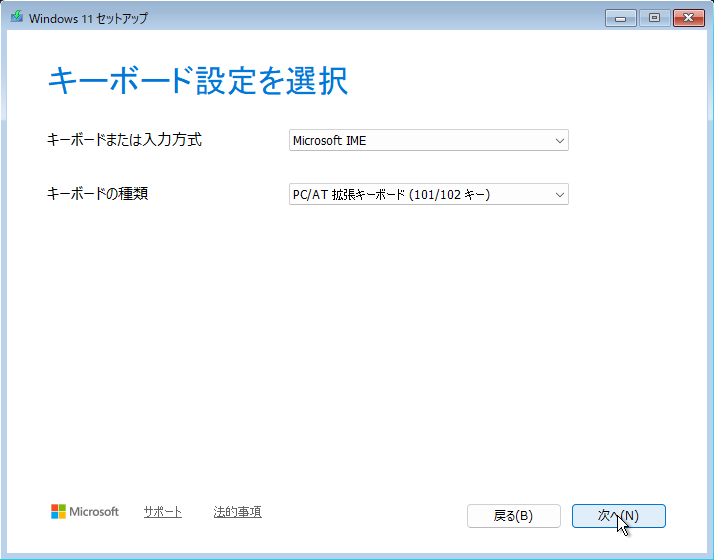

2. `セットアップ オプションの選択` で `Windows 11 のインストール` を選び、`ファイル、アプリ、設定など、すべてが削除されることに同意します(A)` にチェックを入れて `次へ`

    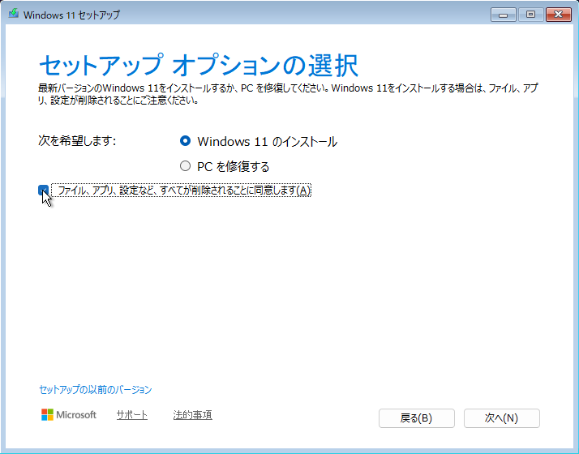

3. `プロダクト キーを入力してください` の画面になる。クリーンインストールの場合ハードウェアの情報を使って認証するので、左下の `プロダクト キーがありません` をクリック

    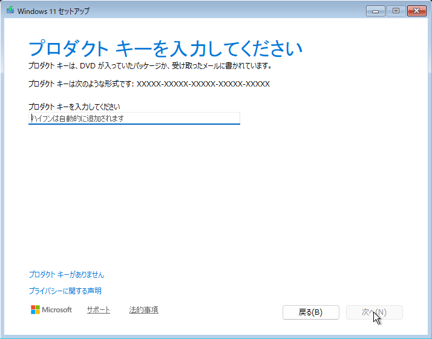

4. `イメージの選択` の画面で、インストールするエディションを選ぶ。選択肢は Home、Education、Pro、Pro Education、Pro for Workstations の 5 つ

    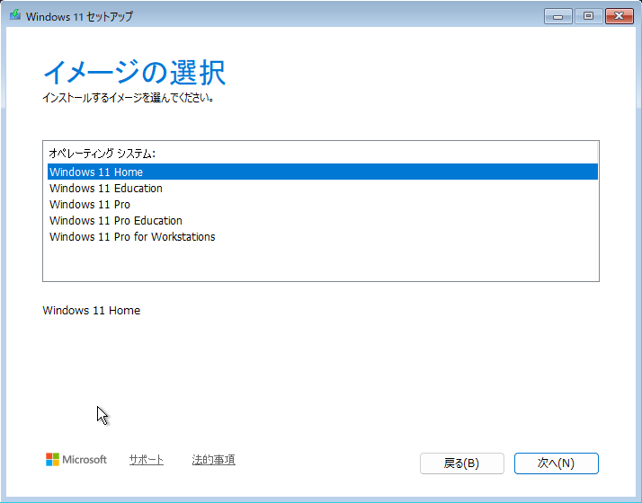

5. ライセンス条項で `同意する(A)` をクリック

    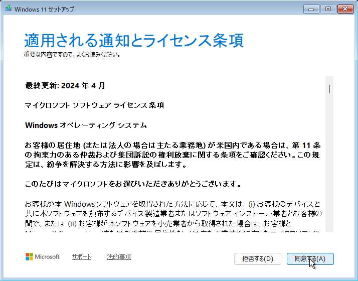

6. `Windows 11 をインストールする場所の選択` に進む。再インストールの場合は、すべてのパーティションを削除し、1 つの `割り当てられていない領域` にする。パーティションを 1 つずつ選んで `パーティションの削除(D)` をクリックする。確認の画面は出ない。システム、MSR、Windows 本体、回復の 4 つがあり、回復パーティションも削除する。新しい空のディスクでは、この手順は不要

    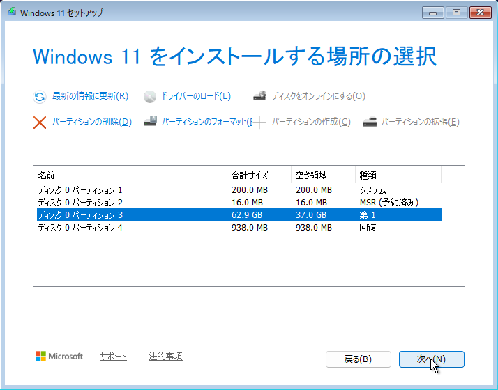

7. `割り当てられていない領域` を選択して `次へ` をクリックする。パーティションを事前に作る必要はなく、インストーラーが自動で作る

    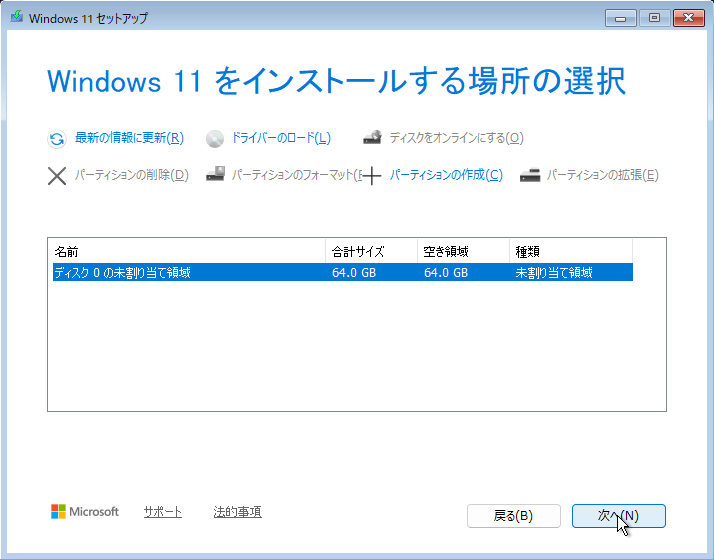

8. `インストール準備完了` で、`Windows 11 Home をインストール`（Pro を選んだ場合は `Windows 11 Pro をインストール`）と `何も引き継がない` が表示されていることを確認し、`インストール(I)` をクリックする

    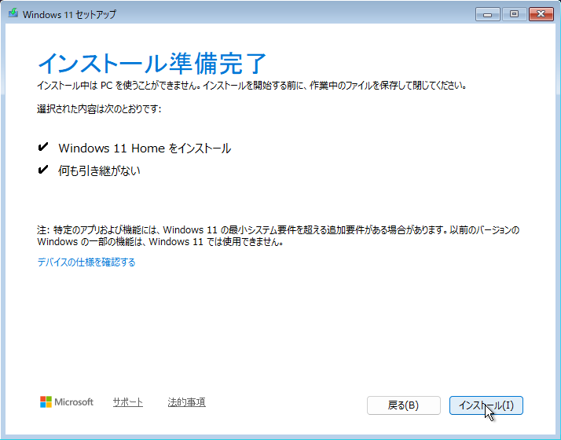

9. `Windows 11 をインストールしています` の画面で進捗が表示され、数回再起動する。終わると、国や地域を選ぶ画面になる

## インストール時の初期設定

参考: https://a-zs.net/win11_msaccountkaihi/

Windows 11 のインストール処理が終わると、国や地域を選ぶ画面が表示される。

Microsoft アカウントを利用するならこのまま進んでも良い。ネットワークに接続していると、更新プログラムの確認とデバイス名の入力（`スキップ` できる）を経て、`Microsoft エクスペリエンスのロックを解除する` で Microsoft アカウントのサインインを求められる。Home では、ここにローカルアカウントへの導線はない。

ローカルアカウントを利用するなら、次のいずれかの方法を使う。

### `start ms-cxh:localonly`（Home、Pro）

1. OOBE の画面（`ネットワークに接続しましょう` や `Microsoft エクスペリエンスのロックを解除する`）で ++shift+f10++ を押し、コマンド プロンプトを開く
2. 次のコマンドを実行する

    ```cmd
    start ms-cxh:localonly
    ```

3. `この PC のユーザーを作成します` という画面が開く。ユーザー名、パスワード（2 回）、パスワードを忘れた場合の質問 3 問と答えを入力して `次へ(N)` を押す

    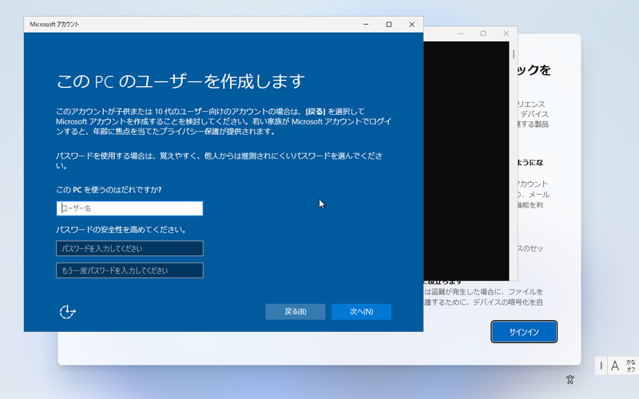

ネットワークの有無にかかわらず動く。`BypassNRO.cmd` を先に実行する必要はない。

### Pro の「ドメインに参加する」経路

Pro だけに出る画面を使う。コマンドは不要で、ネットワークに接続したまま進められる。

1. `このデバイスをどのように設定しますか?` で `職場または学校用に設定する` を選んで `次へ`
2. Microsoft のサインイン画面で、メールアドレス欄の下の `サインイン オプション` をクリック

    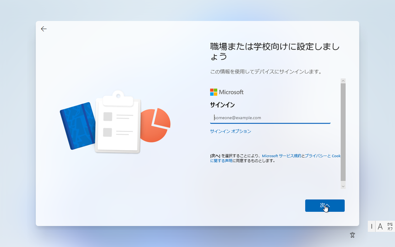

3. `代わりにドメインに参加する` をクリックする。ローカルアカウントの入力画面（`このデバイスを使うのはだれですか?`）に進む

    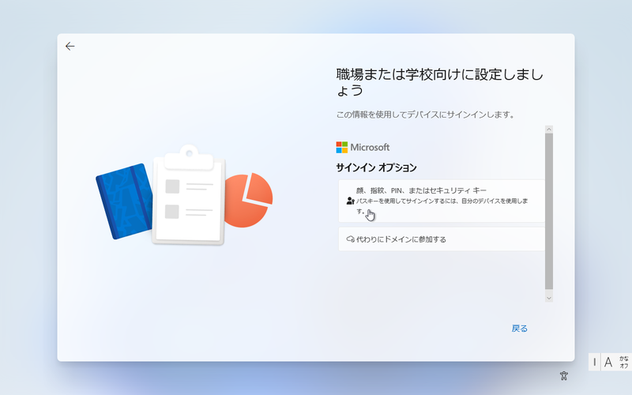

### `BypassNRO.cmd`（ネットワークに接続していない場合）

ネットワークに接続していないときだけ使える。接続済みだと、再起動してもネットワーク画面が出ない。

1. ネットワークから切り離す（LAN ケーブルを抜き、Wi-Fi にも接続しない）
2. OOBE で ++shift+f10++ を押し、コマンド プロンプトを開く
3. 次のコマンドを実行する。自動で再起動し、OOBE が国の選択から再開する

    ```cmd
    oobe\BypassNRO.cmd
    ```

4. 国の設定とキーボード レイアウトのあと、`ネットワークに接続しましょう` に `インターネットに接続していません` のリンクが表示される。これをクリックすると、`このデバイスを使うのはだれですか?` に進む

    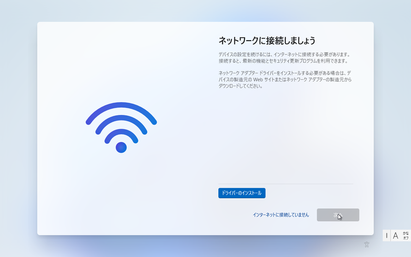

`C:\Windows\System32\oobe\BypassNRO.cmd` の中身は、次の 3 行。ファイルがない場合は、`reg add` と `shutdown` を手で実行する。

```cmd
@echo off
reg add HKLM\SOFTWARE\Microsoft\Windows\CurrentVersion\OOBE /v BypassNRO /t REG_DWORD /d 1 /f
shutdown /r /t 0
```

### ローカルアカウントの入力

どの方法でも、入力する内容は同じ。

- `このデバイスを使うのはだれですか?`: ここで入力した文字列がユーザー名となり、ユーザーフォルダ名（`C:\Users\<ユーザー名>`）にもなる。アルファベットで入力するのが無難
- `確実に覚えやすいパスワードを作成します`: ログイン時のパスワードを設定（次の画面で再入力）
- `ここでセキュリティの質問を追加します`: 6 種類から 3 問を選んで答えを入力する。3 問とも必須
- `デバイスのプライバシー設定の選択`: お好きにだが、すべてオフ（拒否）で良い。5 つのトグル（位置情報、デバイスの検索、診断データ、手書き入力とタイプ入力、パーソナライズされたオファー）があり、初期値はすべてオン。1 つ切り替えるたびに配置がずれる

デスクトップが表示されれば、Windows 11 のインストールと初期設定は完了。  
この後は利便性を上げるための設定をする。

## Windows Update の実施

デバイスドライバーなどの関係で、この段階で Windows Update をしておくのが良い。  
Windows Update で入らないドライバーは別途インストールを行う。

ネットワークに接続した状態で初期設定を進めた場合、OOBE のなかで更新が入る。ネットワークなしで進めた場合は、デスクトップで更新する。

## Windows を使う上での推奨設定

Windows を使う上での個人的なおすすめ設定を行う。

### デバイス名の変更

`システムのプロパティ`（`SystemPropertiesComputerName.exe`）の `コンピューター名/ドメイン名の変更` で変更する。  
変更後は再起動が必要で、デバイス名は Firefox が利用するので最初にやったほうがよい。

ネットワークに接続した状態で初期設定を進めると、OOBE に `デバイス名を入力` の画面が出る。ここで名前をつけることもできる（つけると再起動する）。
`詳細オプションを表示する` を開くと、後から変更できない `ユーザー フォルダー名` を指定する欄もある。指定しない場合は、ユーザー名がフォルダ名になる。

コマンドラインからも変更可能。**管理者権限で** PowerShell を開いて以下を実行。

```powershell
Rename-Computer -NewName "<COMPUTER-NAME>"
Add-Computer -WorkgroupName "<WORKGROUP-NAME>"
Restart-Computer
```

`wmic` は Windows 11 から削除されていて、26300.9711 では実行できない（[KB5067470](https://support.microsoft.com/help/5067470)）。上の PowerShell のコマンドを実行すると、`変更は、コンピューター <旧名> の再起動後に有効になります。` という警告が 2 回表示される。再起動後に、デバイス名とワークグループが変わる。

### ブラウザのインストール

Chrome や Firefox など、お好きなブラウザをインストールする。以下はインストールページへのリンク。

- [Chrome](https://www.google.com/intl/ja_jp/chrome/)
- [Firefox](https://www.firefox.com/ja/download/windows/)

### エクスプローラの設定

まず、隠しフォルダ・ファイルと拡張子を表示する設定をする。

エクスプローラを開き、上部ナビゲーションバーの `表示` から `表示` を開き、以下の設定をする。

- [x] `ファイル名拡張子`
- [x] `隠しファイル`


（26300.9711 の `表示` メニュー。`ファイル名拡張子` と `隠しファイル` にチェックが付いている）

さらに、`・・・` から `オプション` を開き、以下の設定も行う。

- `全般` タブ
  - `エクスプローラーで開く`: `PC`
  - `プライバシー`
    - [ ] `最近使用したファイルを表示する`
    - [ ] `使用頻度の高いフォルダーを表示する`
    - [ ] `推奨セクションを表示する`
    - [ ] `アカウント ベースの分析情報、最近使用したファイル、お気に入りファイル、おすすめのファイルを含める`

`推奨セクションを表示する` をオンにすると、ホームの `クイック アクセス` が消えて、推奨ファイルの領域に置き換わる（ローカル アカウントでは「表示できるファイルがまだありません」と出る）。オフにすると `クイック アクセス` に戻る。`アカウント ベースの分析情報、最近使用したファイル、お気に入りファイル、おすすめのファイルを含める` をオフにすると、アカウントやクラウドのアクティビティにもとづく項目がホームの一覧に含まれなくなる（[参考](https://windowslatest.com/2025/01/31/windows-11s-file-explorer-is-getting-recommended-feed-with-microsoft-account-integration)）。ローカル アカウントでは、この項目を切り替えても表示に変化はなかった。`使用頻度の高いフォルダーを表示する` をオフにすると、ホームの `クイック アクセス` が消える。

コマンドラインで設定する場合は、PowerShell で以下を実行する。エクスプローラを開き直すと反映される。

```powershell
$adv = 'HKCU:\Software\Microsoft\Windows\CurrentVersion\Explorer\Advanced'
Set-ItemProperty $adv HideFileExt 0                  # ファイル名拡張子を表示（隠す場合は 1）
Set-ItemProperty $adv Hidden 1                       # 隠しファイルを表示（隠す場合は 2）
Set-ItemProperty $adv LaunchTo 1                     # エクスプローラーで開く: PC（ホームは 0）
Set-ItemProperty HKCU:\Software\Microsoft\Windows\CurrentVersion\Explorer ShowFrequent 0  # 使用頻度の高いフォルダーを表示しない
```

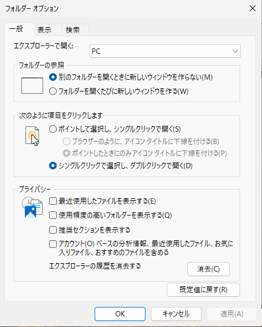

`最近使用したファイルを表示する` は、スタートの設定と連動している（後述）。

増えた項目のコマンドは次のとおり（フォルダ オプションで切り替えた結果と一致した）。

```powershell
$ex = 'HKCU:\Software\Microsoft\Windows\CurrentVersion\Explorer'
Set-ItemProperty $ex ShowRecommendations 1           # 推奨セクションを表示する（オフは 0）
Set-ItemProperty $ex ShowCloudFilesInQuickAccess 0   # アカウント ベースの分析情報、最近使用したファイル、…を含めない
```

フォルダ オプションは、`rundll32 shell32.dll,Options_RunDLL 0` でも開ける（このときのタイトルは `エクスプローラーのオプション`）。

### タスクバーの設定

設定アプリを開き、`個人用設定` から `タスクバー` を開き、以下の設定をする。

[`個人用設定 -> タスクバー` を開く](ms-settings:taskbar){ .md-button }

- `タスクバー項目`
  - `検索`: `非表示`
  - `タスク ビュー`: `オフ`
  - `ウィジェット`: `オフ`
- `タスク バーの動作`
  - `タスク バー アイコンの配置`: `左揃え`

`タスク バー アイコンの配置` の既定は `中央揃え`。このほかに、`タスク バーの位置`（下、上、左、右）、`タスク バーのサイズ調整`、`再開`、`タスク バーからウィンドウを共有する`、`縮小したアプリ アイコンを表示` などの項目がある。

コマンドラインで設定する場合は、PowerShell で以下を実行する（エクスプローラを再起動しなくても反映される）。

```powershell
$adv = 'HKCU:\Software\Microsoft\Windows\CurrentVersion\Explorer\Advanced'
Set-ItemProperty HKCU:\Software\Microsoft\Windows\CurrentVersion\Search SearchboxTaskbarMode 0  # 検索: 非表示（検索ボックスは 2）
Set-ItemProperty $adv ShowTaskViewButton 0           # タスク ビュー: オフ
Set-ItemProperty $adv TaskbarAl 0                    # アイコンの配置: 左揃え（中央揃えは 1）
```

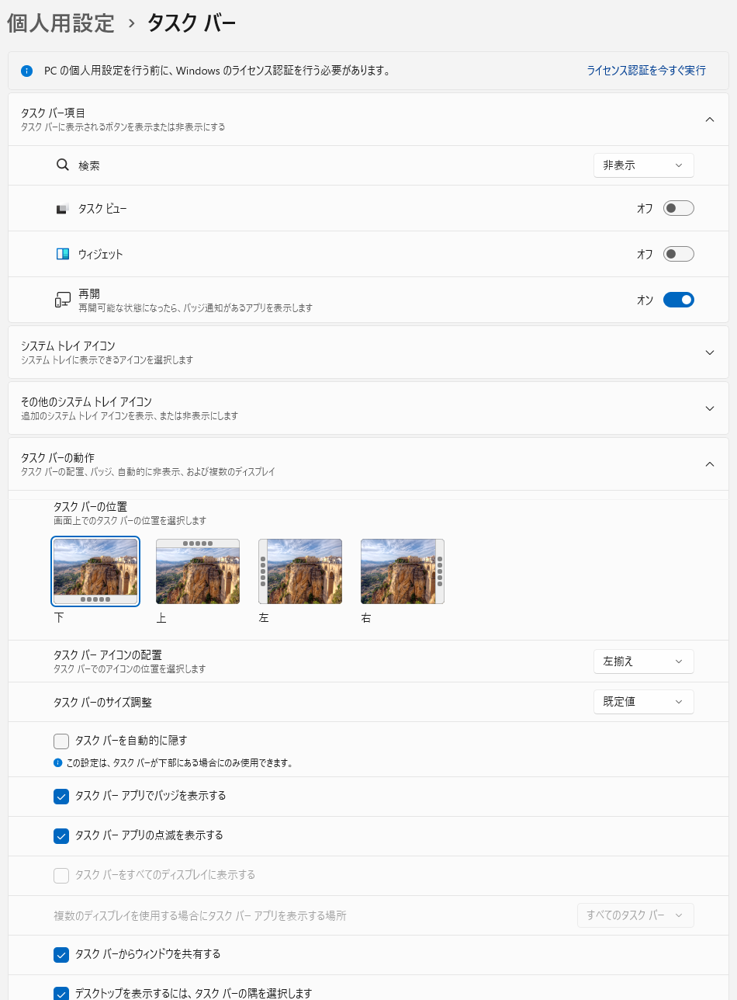

増えた項目は、レジストリで次のように設定できる。

| 設定アプリの項目 | 効果 | コマンド（PowerShell） |
|---|---|---|
| `再開` | 再開可能な状態になったとき、バッジ通知があるアプリを表示する | `Set-ItemProperty $adv IsEnabled 0`（オフ。オンは `1`） |
| `タスク バーからウィンドウを共有する` | タスクバーのウインドウから共有できるようにする | `Set-ItemProperty $adv TaskbarSn 0`（オフ） |
| `タスク バー アプリの点滅を表示する` | アプリの通知でタスクバーのボタンが点滅する | `Set-ItemProperty $adv TaskbarFlashing 0`（オフ） |
| `タスク バー アプリでバッジを表示する` | ボタンにバッジ（未読数など）を表示する | `Set-ItemProperty $adv TaskbarBadges 0`（オフ） |
| `デスクトップを表示するには、タスク バーの隅を選択します` | タスクバー右端のクリックでデスクトップを表示する | `Set-ItemProperty $adv TaskbarSd 0`（オフ） |
| `タスク バーのサイズ調整` | タスクバーの高さ | `Set-ItemProperty $adv TaskbarSi 0`（小。既定は `1`） |
| `タスク バーのボタンをまとめラベルを非表示にする` | ボタンをまとめるか、ラベルを表示するか | `Set-ItemProperty $adv TaskbarGlomLevel 2`（まとめない。ラベルが表示される。既定は `0` の常時） |

`タスク バーの位置` と `タスク バーを自動的に隠す` は、`HKCU:\Software\Microsoft\Windows\CurrentVersion\Explorer\StuckRects3` の `Settings`（48 バイトのバイナリ）にある。次の 2 か所を使う。変更後はエクスプローラを再起動する。

- 12 バイト目（添字 12）: 位置。`0` が左、`1` が上、`2` が右、`3` が下
- 9 バイト目（添字 8）: 自動的に隠す。`2` が通常、`3` が隠す

```powershell
$p = 'HKCU:\Software\Microsoft\Windows\CurrentVersion\Explorer\StuckRects3'
$v = (Get-ItemProperty $p).Settings
$v[12] = 1                                           # タスクバーを上に（下は 3）
$v[8] = 2                                            # 自動的に隠さない（隠す場合は 3）
Set-ItemProperty $p Settings $v
Stop-Process -Name explorer -Force
```

`縮小したアプリ アイコンを表示` は `$adv` の `IconSizePreference` で、`0` が `常時`、`1` が `なし`、`2` が `タスク バーに入りきらない場合`（既定。値なしでも同じ）。

`ウィジェット` は、ユーザー単位のレジストリ値 `HKCU:\Software\Microsoft\Windows\CurrentVersion\Explorer\Advanced` の `TaskbarDa`（`0` でオフ）で、設定アプリのトグルはこの値を書き換える。ただし、PowerShell や `reg` からは書き込めない。管理者で実行しても、実行ファイル名を変えても「アクセスが拒否されました」になる。コマンドラインで消す場合は、管理者の PowerShell で次のポリシーを設定する。PC 全体に適用され、設定アプリのトグルがグレーアウトのオフになる。

```powershell
reg add HKLM\SOFTWARE\Policies\Microsoft\Dsh /v AllowNewsAndInterests /t REG_DWORD /d 0 /f
Stop-Process -Name explorer -Force                   # エクスプローラーを再起動
```

### スタートメニューのカスタマイズ

設定アプリにて、`個人用設定` → `スタート` に進み、以下を変更。

[`個人用設定 -> スタート` を開く](ms-settings:personalization-start){ .md-button }

- `新着順` の下
  - `最近追加したアプリを表示する`: オフ
  - `最近使ったファイルとおすすめのファイルを表示する`: オフ
  - `ヒントとアプリの推奨事項を表示する`: オフ
- `すべて` の下の `最もよく使用するアプリを表示する (グリッド ビューとリスト ビューのみ)`: オフ（既定でオフ）
- `アカウントに関連する通知を表示`: オフ
- `ジャンプ リストとエクスプローラーで最近使った項目を表示します`: オフ

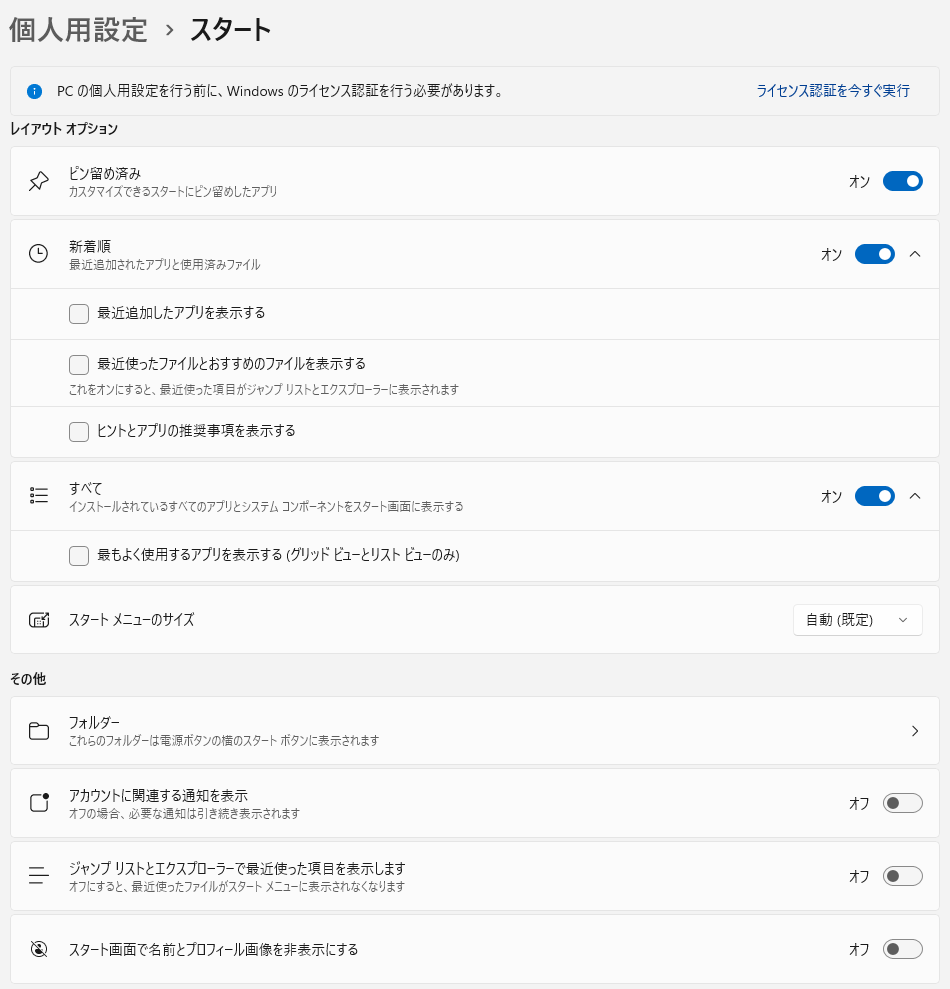

`ジャンプ リストとエクスプローラーで最近使った項目を表示します` をオフにすると、`最近使ったファイルとおすすめのファイルを表示する` のチェックと、エクスプローラの `フォルダー オプション` の `最近使用したファイルを表示する` も一緒にオフになる。3 か所が連動している。

コマンドラインで設定する場合は、PowerShell で以下を実行する（再起動しなくても反映される）。

```powershell
$adv = 'HKCU:\Software\Microsoft\Windows\CurrentVersion\Explorer\Advanced'
Set-ItemProperty $adv Start_IrisRecommendations 0    # ヒントとアプリの推奨事項を表示する: オフ
Set-ItemProperty $adv Start_AccountNotifications 0   # アカウントに関連する通知を表示: オフ
Set-ItemProperty $adv Start_TrackDocs 0              # 最近使った項目を表示: オフ
Set-ItemProperty HKCU:\Software\Microsoft\Windows\CurrentVersion\Start ShowFrequentList 0  # 最もよく使用するアプリを表示する: オフ
```

`Start_TrackProgs` は `最もよく使用するアプリを表示する` のチェックボックスに反映されなかった。

次の項目も、`HKCU:\Software\Microsoft\Windows\CurrentVersion\Start` の値で切り替えられる（既定では値が存在せず、オン扱い）。

| 設定アプリの項目 | コマンド（PowerShell） |
|---|---|
| `最近追加したアプリを表示する` | `Set-ItemProperty $start ShowRecentList 0` |
| `最近使ったファイルとおすすめのファイルを表示する` | `Set-ItemProperty $start ShowSuggestedFiles 0` |
| `新着順`（トグル） | `Set-ItemProperty $start ShowRecentSection 0` |
| `ピン留め済み`（トグル） | `Set-ItemProperty $start ShowPinnedSection 0` |
| `すべて`（トグル） | `Set-ItemProperty $start ShowAllAppsSection 0` |
| `スタート画面で名前とプロフィール画像を非表示にする`（オンにする） | `Set-ItemProperty $start HideUserInformation 1` |
| `スタート メニューのサイズ` | `Set-ItemProperty $start StartMenuSize 1`（`1` が小、`2` が大。既定の `自動` は値なし） |

`$start` は `'HKCU:\Software\Microsoft\Windows\CurrentVersion\Start'`。`新着順` をオフにすると、下の 3 つのチェックボックスが無効になって `最近追加したアプリを表示する` と `最近使ったファイルとおすすめのファイルを表示する` のチェックが外れる（`ヒントとアプリの推奨事項を表示する` は、チェックが付いたまま無効になる）。

### テーマ・色の設定

設定アプリを開き、`個人用設定` から `テーマ` や `色` を選び、好みのテーマや色を選択する。

- [`個人用設定 -> テーマ` を開く](ms-settings:themes){ .md-button }
- [`個人用設定 -> 色` を開く](ms-settings:colors){ .md-button }

`ms-settings:themes`、`ms-settings:colors` は、26300.9711 でそれぞれ `個人用設定 › テーマ`、`個人用設定 › 色` を開いた（Win+R に直接入力して確認。Win+R では `start` は使えない）。

### ユーザーフォルダの移動

C ドライブにあるユーザーフォルダを別ドライブに移動する場合、以下の手順を踏む。

GUI から変更する場合は、ユーザーフォルダを開き 1 つずつ `プロパティ` -> `場所` -> アドレスを変更 -> `OK` -> `はい` で移動できる（26300.9711 でダウンロードを `C:\TestUF2\Downloads` に移動して確認した）。

1. `C:\Users\<User>` を開く（`%HOMEDRIVE%%HOMEPATH%`）
2. 後述するフォルダのプロパティを開く
3. `場所` タブを開く
4. 保管場所のアドレスを変更する
5. `OK` をクリック
6. `フォルダーの作成` 画面が開くので、`はい` をクリック
7. `フォルダーの移動` 画面が開くので、`はい` をクリック

移動対象のフォルダは以下のとおり。

- `アドレス帳`
- `お気に入り`
- `ダウンロード`
- `デスクトップ`
- `ドキュメント`
- `ピクチャ`
- `ビデオ`
- `ミュージック`
- `リンク`
- `保存したゲーム`
- `検索`

コマンドラインでは、`HKCU:\Software\Microsoft\Windows\CurrentVersion\Explorer\User Shell Folders` の値を書き換えて、エクスプローラを再起動する。値の名前は次のとおり。

- `ダウンロード`: `{374DE290-123F-4565-9164-39C4925E467B}`
- `デスクトップ`: `Desktop`
- `ドキュメント`: `Personal`
- `ピクチャ`: `My Pictures`
- `ミュージック`: `My Music`
- `ビデオ`: `My Video`

ダウンロードを `C:\TestUF\Downloads` に変えたところ、再起動後に `shell:Downloads` がそのパスになった。既存のファイルは移動されないので、`Move-Item` で別に移す。

```powershell
$k = 'HKCU:\Software\Microsoft\Windows\CurrentVersion\Explorer\User Shell Folders'
New-Item -ItemType Directory 'D:\Users\Downloads' -Force | Out-Null
Set-ItemProperty $k '{374DE290-123F-4565-9164-39C4925E467B}' 'D:\Users\Downloads'
Stop-Process -Name explorer -Force
```

### クリップボードの履歴機能を有効化

++win+v++ を押すことで、以下のようなクリップボード履歴機能が利用できる。


この機能は有効化しておかないと利用できないので、++win+v++ を押して機能の有効化をしておく。設定アプリの `システム` → `クリップボード` のトグルでも切り替えられる。

コマンドラインで設定する場合は、PowerShell で以下を実行する。サインアウトしてサインインし直すと設定アプリのトグルに反映される（`cbdhsvc` サービスの再起動だけでは反映されなかった）。

```powershell
New-Item -Force HKCU:\Software\Microsoft\Clipboard
Set-ItemProperty HKCU:\Software\Microsoft\Clipboard EnableClipboardHistory 1   # 無効にする場合は 0
```

### ウインドウを選ぶ時の全画面プレビューを無効化

デフォルトの設定では、タスクバーからウィンドウを選ぶだけでほかのウィンドウが透明化される。  
個人的にはこの挙動はウザいので、機能を無効にする。

1. `Windows のデザインとパフォーマンスの調整`（`SystemPropertiesPerformance.exe`）を開く
2. `視覚効果` タブにて、`プレビューを有効にする` のチェックボックスを **オフ** にする

コマンドラインで設定する場合は、PowerShell で以下を実行する。`視覚効果` タブが `カスタム` になり、`プレビューを有効にする` が外れた状態で開く。`VisualFXSetting` が `3`（カスタム）でないと、自動選択のままチェックが付いた表示になる。

```powershell
Set-ItemProperty HKCU:\Software\Microsoft\Windows\CurrentVersion\Explorer\VisualEffects VisualFXSetting 3
Set-ItemProperty HKCU:\Software\Microsoft\Windows\DWM EnableAeroPeek 0   # オンに戻す場合は 1
```

### Windows の通知サウンドを切る

Windows はことあるごとに通知音を鳴らしてうるさいので、Windows の通知音を鳴らさないようにする。

1. `システム サウンドの変更` を開く  
   この設定は、[設定アプリの `システム -> サウンド`](ms-settings:sound) の `すべてのサウンド デバイス` と `音量ミキサー` の下にある `サウンドの詳細設定` からアクセスできる。`mmsys.cpl` を実行しても同じ「サウンド」画面が開く
2. `サウンド` タブを開く
3. `サウンド設定` を `サウンドなし` に変更
4. `OK` で保存

コマンドラインでは、PowerShell で以下を実行する。「サウンド」画面の `サウンド設定` が `サウンドなし` になる。`Windows スタートアップのサウンドを再生する` のチェックは変わらない。

1 行目はスキームの名前を `.None` にするだけで、各イベントの `.Current` には wav のパスが残る（通知音 `Notification.Default` は `Windows Notify System Generic.wav` のまま）。GUI で `サウンドなし` を選ぶと、スキーム名が `.None` になり、各イベントの `.Current` も空になる。コマンドラインでも同じ状態にするため、2 つ目の処理でイベントの `.Current` を空にしている。

```powershell
Set-ItemProperty HKCU:\AppEvents\Schemes '(default)' '.None'
Get-ChildItem 'HKCU:\AppEvents\Schemes\Apps\*\*' | ForEach-Object {
    $c = Join-Path $_.PSPath '.Current'
    if (Test-Path $c) { Set-ItemProperty $c '(default)' '' }
}
```

### 通信アクティビティの設定

Discord などで通話中にほかの音量が下がってしまう問題を解決するため、通信アクティビティで音量を変更しないようにする。

1. `システム サウンドの変更` を開く
2. `通信` タブを開く
3. `Windows が通信アクティビティを検出したとき:` で `何もしない` を選択
4. `OK` で保存する

コマンドラインで設定する場合は、PowerShell で以下を実行する。値は `0` がミュート、`1` が 80% 下げる（既定）、`2` が 50% 下げる、`3` が何もしない。

```powershell
New-Item -Force HKCU:\Software\Microsoft\Multimedia\Audio
Set-ItemProperty HKCU:\Software\Microsoft\Multimedia\Audio UserDuckingPreference 3
```

### モニターのリフレッシュレート設定

モニターが 144 Hz などの高いリフレッシュレートに対応している場合、設定を変更する必要がある。

設定アプリを開き、`システム` から `ディスプレイ` を開き、以下の設定をする。

[`システム -> ディスプレイ` を開く](ms-settings:display){ .md-button }

1. 下にスクロールし、`関連設定` の `ディスプレイの詳細設定`（説明は `ディスプレイ情報、リフレッシュ レート`）をクリック。複数のモニターがある場合は、ここで対象のモニターを選ぶ
2. `リフレッシュ レートの選択` にて、選択可能な一番高いリフレッシュレートを選ぶ

### 起動時の「PCのセットアップを完了しましょう」を止める

- 参考: https://atmarkit.itmedia.co.jp/ait/articles/2403/18/news021.html

設定アプリを開き、`システム` から `通知` を開き、以下の設定をする。

[`システム -> 通知` を開く](ms-settings:notifications){ .md-button }

1. 下にスクロールし、 `追加の設定` をクリック
2. すべてのチェックボックスのチェックを外す

チェックボックスは 2 つ（既定はどちらもオン）。

- `Windows を最大限に活用し、このデバイスの設定を完了する方法を提案する`
- `Windows を使用する際のヒントや提案を入手する`

コマンドラインで設定する場合は、PowerShell で以下を実行する。2 つのチェックがどちらも外れた状態になる。

```powershell
New-Item -Force HKCU:\Software\Microsoft\Windows\CurrentVersion\UserProfileEngagement
Set-ItemProperty HKCU:\Software\Microsoft\Windows\CurrentVersion\UserProfileEngagement ScoobeSystemSettingEnabled 0
$cdm = 'HKCU:\Software\Microsoft\Windows\CurrentVersion\ContentDeliveryManager'
Set-ItemProperty $cdm SubscribedContent-310093Enabled 0
Set-ItemProperty $cdm SubscribedContent-338389Enabled 0
```

### NVIDIA app をインストールし、ディスプレイドライバーを入れる

NVIDIA のグラボを刺している場合、サブディスプレイはディスプレイドライバーを入れないと利用できない（らしい）。  
GeForce Experience は NVIDIA app に置き換えられた。[NVIDIA app のページ](https://www.nvidia.com/ja-jp/software/nvidia-app/) から、インストーラーをダウンロード、インストールする。

その後、ドライバータブから GeForce Game Ready ドライバーをインストールする。

## 高度な初期設定

### 標準アプリケーションを削除

Windows は標準で不要なアプリケーションを大量にインストールするので、これを PowerShell からまとめてアンインストールする。

参考: https://ygkb.jp/22500#delete-all

とりあえず、私の環境では以下はいらないので実行

```powershell
Get-AppxPackage Clipchamp.Clipchamp | Remove-AppxPackage                       # Clipchamp
Get-AppxPackage Microsoft.549981C3F5F10 | Remove-AppxPackage                   # Cortana（26300.9711 の Home・Pro では存在しない）
Get-AppxPackage Disney.37853FC22B2CE | Remove-AppxPackage                      # Disney+（26H2 の Home・Pro では存在しない）
Get-AppxPackage MSTeams | Remove-AppxPackage                                   # Microsoft Teams（新しい Teams）
Get-AppxPackage MicrosoftTeams | Remove-AppxPackage                            # Microsoft Teams（旧 Chat 用。26300.9711 の Home では存在しない）
Get-AppxPackage Microsoft.Todos | Remove-AppxPackage                           # Microsoft To Do
Get-AppxPackage Microsoft.MicrosoftOfficeHub | Remove-AppxPackage              # Office on the Webへようこそ（26H2 では Pro のみ存在する）
Get-AppxPackage Microsoft.MicrosoftSolitaireCollection | Remove-AppxPackage    # Solitaire
Get-AppxPackage SpotifyAB.SpotifyMusic | Remove-AppxPackage                    # Spotify（26H2 の Home・Pro では存在しない）
Get-AppxPackage Microsoft.GamingApp | Remove-AppxPackage                       # Xbox ストア画面
Get-AppxPackage Microsoft.XboxGamingOverlay | Remove-AppxPackage               # Xbox Game Bar
Get-AppxPackage Microsoft.Xbox.TCUI | Remove-AppxPackage                       # Xbox その他
Get-AppxPackage Microsoft.XboxGameOverlay | Remove-AppxPackage                 # Xbox その他（26300.9711 の Home・Pro では存在しない）
Get-AppxPackage Microsoft.XboxIdentityProvider | Remove-AppxPackage            # Xbox その他
Get-AppxPackage Microsoft.XboxSpeechToTextOverlay | Remove-AppxPackage         # Xbox その他
Get-AppxPackage Microsoft.ZuneVideo | Remove-AppxPackage                       # 映画 & テレビ（26300.9711 の Home・Pro では存在しない）
Get-AppxPackage Microsoft.WindowsCamera | Remove-AppxPackage                   # カメラ
Get-AppxPackage Microsoft.YourPhone | Remove-AppxPackage                       # スマホ同期
Get-AppxPackage Microsoft.BingWeather | Remove-AppxPackage                     # 天気
Get-AppxPackage Microsoft.Getstarted | Remove-AppxPackage                      # ヒント（26300.9711 の Home・Pro では存在しない）
Get-AppxPackage Microsoft.WindowsFeedbackHub | Remove-AppxPackage              # フィードバック Hub
Get-AppxPackage Microsoft.WindowsSoundRecorder | Remove-AppxPackage            # ボイス レコーダー
Get-AppxPackage Microsoft.WindowsMaps | Remove-AppxPackage                     # マップ（26300.9711 の Home・Pro では存在しない）
Get-AppxPackage microsoft.windowscommunicationsapps | Remove-AppxPackage       # メール、カレンダー（26300.9711 の Home・Pro では存在しない）
Get-AppxPackage Microsoft.ZuneMusic | Remove-AppxPackage                       # メディアプレーヤー
Get-AppxPackage Microsoft.BingNews | Remove-AppxPackage                        # ニュース
Get-AppxPackage Microsoft.GetHelp | Remove-AppxPackage                         # ヘルプ
Get-AppxPackage Microsoft.People | Remove-AppxPackage                          # People（26300.9711 の Home・Pro では存在しない）
Get-AppxPackage MicrosoftCorporationII.QuickAssist | Remove-AppxPackage        # クイック アシスト
Get-AppxPackage Microsoft.Copilot | Remove-AppxPackage                         # Copilot（26H2 では Home のみ存在する）
Get-AppxPackage Microsoft.OutlookForWindows | Remove-AppxPackage               # 新しい Outlook
Get-AppxPackage Microsoft.BingSearch | Remove-AppxPackage                      # Bing 検索
Get-AppxPackage Microsoft.PowerAutomateDesktop | Remove-AppxPackage            # Power Automate
Get-AppxPackage Microsoft.Windows.DevHome | Remove-AppxPackage                 # Dev Home
```

「26300.9711 の Home・Pro では存在しない」と書いたものは、最初から入っていなかった。実行しても何も起きない（エラーにもならない）。

`Remove-AppxPackage` は、実行したユーザーからアプリを削除するだけで、新しく作るユーザーには再び入る。すべてのユーザーから消してプロビジョニングも外す場合は、**管理者権限で** `-AllUsers` をつける。

```powershell
Get-AppxPackage -AllUsers Microsoft.Todos | Remove-AppxPackage -AllUsers
```

`Microsoft.WindowsStore`、`Microsoft.WindowsTerminal`、`Microsoft.WindowsNotepad`、`Microsoft.Paint`、`Microsoft.Windows.Photos` なども削除できるが、削除すると困るので通常は残す。

削除したアプリは Microsoft Store から再インストールできる。26300.9711 の Pro で、削除（`-AllUsers`）してから `winget install -e --id <ID> --source msstore` で入れ直し、パッケージが戻ることを確認した。Solitaire は `winget` では `No package found matching input criteria.` になったが、Store のページは開ける。Dev Home は `winget search` で見つからなかった。

| アプリ | パッケージ名 | Store |
| --- | --- | --- |
| Clipchamp | `Clipchamp.Clipchamp` | [9P1J8S7CCWWT](https://apps.microsoft.com/detail/9p1j8s7ccwwt) |
| Microsoft Teams | `MSTeams` | [XP8BT8DW290MPQ](https://apps.microsoft.com/detail/xp8bt8dw290mpq) |
| Microsoft To Do | `Microsoft.Todos` | [9NBLGGH5R558](https://apps.microsoft.com/detail/9nblggh5r558) |
| Solitaire | `Microsoft.MicrosoftSolitaireCollection` | [9WZDNCRFHWD2](https://apps.microsoft.com/detail/9wzdncrfhwd2) |
| Xbox | `Microsoft.GamingApp` | [9MV0B5HZVK9Z](https://apps.microsoft.com/detail/9mv0b5hzvk9z) |
| Xbox Game Bar | `Microsoft.XboxGamingOverlay` | [9NZKPSTSNW4P](https://apps.microsoft.com/detail/9nzkpstsnw4p) |
| Xbox Identity Provider | `Microsoft.XboxIdentityProvider` | [9WZDNCRD1HKW](https://apps.microsoft.com/detail/9wzdncrd1hkw) |
| カメラ | `Microsoft.WindowsCamera` | [9WZDNCRFJBBG](https://apps.microsoft.com/detail/9wzdncrfjbbg) |
| スマートフォン連携 | `Microsoft.YourPhone` | [9NMPJ99VJBWV](https://apps.microsoft.com/detail/9nmpj99vjbwv) |
| 天気 | `Microsoft.BingWeather` | [9WZDNCRFJ3Q2](https://apps.microsoft.com/detail/9wzdncrfj3q2) |
| フィードバック Hub | `Microsoft.WindowsFeedbackHub` | [9NBLGGH4R32N](https://apps.microsoft.com/detail/9nblggh4r32n) |
| ボイス レコーダー | `Microsoft.WindowsSoundRecorder` | [9WZDNCRFHWKN](https://apps.microsoft.com/detail/9wzdncrfhwkn) |
| メディア プレーヤー | `Microsoft.ZuneMusic` | [9WZDNCRFJ3PT](https://apps.microsoft.com/detail/9wzdncrfj3pt) |
| ニュース | `Microsoft.BingNews` | [9WZDNCRFHVFW](https://apps.microsoft.com/detail/9wzdncrfhvfw) |
| ヘルプ | `Microsoft.GetHelp` | [9PKDZBMV1H3T](https://apps.microsoft.com/detail/9pkdzbmv1h3t) |
| クイック アシスト | `MicrosoftCorporationII.QuickAssist` | [9P7BP5VNWKX5](https://apps.microsoft.com/detail/9p7bp5vnwkx5) |
| 新しい Outlook | `Microsoft.OutlookForWindows` | [9NRX63209R7B](https://apps.microsoft.com/detail/9nrx63209r7b) |
| Bing 検索 | `Microsoft.BingSearch` | [9NZBF4GT040C](https://apps.microsoft.com/detail/9nzbf4gt040c) |
| Power Automate | `Microsoft.PowerAutomateDesktop` | [9NFTCH6J7FHV](https://apps.microsoft.com/detail/9nftch6j7fhv) |
| Copilot | `Microsoft.Copilot` | [9NHT9RB2F4HD](https://apps.microsoft.com/detail/9nht9rb2f4hd) |

なお、調査は以下のコマンドで実施できる。

```powershell
Get-AppxPackage | Where-Object IsFramework -eq $false | Where-Object NonRemovable -eq $false | Select-Object Name | Sort-Object Name
```

### 不要サービスの停止

PCを利用する上で不要なサービスがあるなら、適宜停止する。コマンドは管理者権限で実施すること。

参考: https://ygkb.jp/22889

26300.9711 の Home で、各サービスの状態を確認した。

- 起動の種類が `自動` なのは `DiagTrack`（実行中）、`TrkWks`（実行中）、`MapsBroker`（停止中）の 3 つだけ。無効化で実際に変わるのは、この 3 つ
- `AxInstSV`、`MSDTC`、`MSiSCSI`、`WPDBusEnum`、`SCardSvr`、`ScDeviceEnum`、`SCPolicySvc`、`SNMPTrap`、`TapiSrv`、`upnphost`、`WMPNetworkSvc`、`RetailDemo`、`CertPropSvc`、`SharedAccess` は、最初から `手動` で停止している。無効化しなくても動かない

```powershell
# Connected User Experiences and Telemetry
sc.exe stop DiagTrack
sc.exe config DiagTrack start=disabled

# Distributed Link Tracking Client
sc.exe stop TrkWks
sc.exe config TrkWks start=disabled

# Downloaded Maps Manager
sc.exe stop MapsBroker
sc.exe config MapsBroker start=disabled
```

以下は、最初から `手動` で停止しているサービス。無効化すると、手動でも起動できなくなる。

```powershell
# ActiveX Installer (AxInstSV)
sc.exe stop AxInstSV
sc.exe config AxInstSV start=disabled

# Distributed Transaction Coordinator
sc.exe stop MSDTC
sc.exe config MSDTC start=disabled

# Microsoft iSCSI Initiator Service
sc.exe stop MSiSCSI
sc.exe config MSiSCSI start=disabled

# Portable Device Enumerator Service
sc.exe stop WPDBusEnum
sc.exe config WPDBusEnum start=disabled

# Smart Card
sc.exe stop SCardSvr
sc.exe config SCardSvr start=disabled

# Smart Card Device Enumeration Service
sc.exe stop ScDeviceEnum
sc.exe config ScDeviceEnum start=disabled

# Smart Card Removal Policy
sc.exe stop SCPolicySvc
sc.exe config SCPolicySvc start=disabled

# SNMP Trap
sc.exe stop SNMPTrap
sc.exe config SNMPTrap start=disabled

# Telephony
sc.exe stop TapiSrv
sc.exe config TapiSrv start=disabled

# UPnP Device Host
sc.exe stop upnphost
sc.exe config upnphost start=disabled

# Windows Media Player Network Sharing Service
sc.exe stop WMPNetworkSvc
sc.exe config WMPNetworkSvc start=disabled

# 市販デモ サービス
sc.exe stop RetailDemo
sc.exe config RetailDemo start=disabled
```

!!! note "無効化しないサービス"
    `CertPropSvc`（Certificate Propagation）は、スマートカードの Plug and Play に必要なサービスで、リモート デスクトップ サービスの依存サービスとして起動される。出典は [Certificate propagation service - Microsoft Learn](https://learn.microsoft.com/en-us/windows/security/identity-protection/smart-cards/smart-card-certificate-propagation-service)。スマートカードやリモート デスクトップを使う場合は無効化しない。最初から `手動` なので、無効化しなくても常時は動いていない。

### ゲーム起動時に Xbox オーバーレイの通知を消す

<!-- textlint-disable preset-ja-technical-writing/no-mix-dearu-desumasu -->
ストアアプリを消したりサービスを止めたことで Minecraft などのゲーム起動時に「この ms-gamingoverlay リンクを開くには新しいアプリが必要です」というポップアップが出る。  
<!-- textlint-enable preset-ja-technical-writing/no-mix-dearu-desumasu -->
これを表示しないようにする。

参考: https://narolll.hateblo.jp/entry/20220503/1651540497

1. レジストリエディタ（`regedit`）を開く
2. `HKEY_CURRENT_USER\Software\Microsoft\Windows\CurrentVersion\GameDVR` に移動
3. 右側のペインで右クリックし、`新規` → `DWORD (32 ビット) 値` から、`AppCaptureEnabled` を作成。キーではなく値を作る
4. `AppCaptureEnabled` をダブルクリックし、値のデータに `0` を入力し `OK` をクリック。

コマンドラインでは、PowerShell で以下を実行する。

```powershell
New-ItemProperty HKCU:\Software\Microsoft\Windows\CurrentVersion\GameDVR -Name AppCaptureEnabled -PropertyType DWord -Value 0 -Force
```

26300.9711 の Home では、`GameDVR` キーには `KGLToGCSUpdatedRevision` と `KGLRevision` の 2 つの値しかなく、`AppCaptureEnabled` は最初から存在しない（`{86ca1aa0-34aa-4e8b-a509-50c905bae2a2}` のサブキーを作る必要はない）。`HKCU\System\GameConfigStore` の `GameDVR_Enabled` は最初から `0`。

ポップアップは、Xbox 系のアプリを削除したあとに `start ms-gamingoverlay://kglcheck` を実行すると再現できた。表示は「アプリを取得してこの 'ms-gamingoverlay' リンクを開く」と「お使いの PC には、このリンクを開くことができるアプリがありません。」。`AppCaptureEnabled` を `0` にすると実際のゲーム起動時のポップアップが消えるかは、ゲームを起動しての確認ができていないので未確認。

### ファイルなどの右クリックメニューを戻す

Windows 11 になって右クリックメニュー（コンテキストメニュー）が簡素化された。これで十分なら良いのだが、そうでないことの方が多いので Windows 10 の時のメニューに戻す。

参考: https://pc-karuma.net/right-click-context-menu-back-on-windows-11/

1. レジストリエディタ（`regedit`）を開く
2. `HKEY_CURRENT_USER\Software\Classes\CLSID` に移動
3. `CLSID` を右クリック
4. `新規` → `キー` から、`{86ca1aa0-34aa-4e8b-a509-50c905bae2a2}` のキーを作成。
5. 作成したキー `{86ca1aa0-34aa-4e8b-a509-50c905bae2a2}` を右クリックし、`新規` → `キー` から、`InprocServer32` を作成。
6. `(既定)` をクリックし、空白の状態で `OK` をクリック
7. タスクマネージャーなどからエクスプローラを再起動

コマンドラインでは、PowerShell で以下を実行する。

```powershell
reg add "HKCU\Software\Classes\CLSID\{86ca1aa0-34aa-4e8b-a509-50c905bae2a2}\InprocServer32" /f /ve
Stop-Process -Name explorer -Force
```

### スタートメニューの Web 検索を無効化する

Windows キーを押してキーワード入力したとき、PC 内のアプリケーションなどを検索できるが、そのときに Web 検索されるのをやめたい。

参考: https://www.tomshardware.com/how-to/disable-windows-web-search

1. レジストリエディタ（`regedit`）を開く
2. `HKEY_CURRENT_USER\Software\Policies\Microsoft\Windows` に移動
3. `Windows` を右クリック
4. `新規` → `キー` から、`Explorer` のキーを作成。
5. 作成したキー `Explorer` を右クリックし、`新規` → `DWORD (32 ビット) 値` から、`DisableSearchBoxSuggestions` を作成。
6. `DisableSearchBoxSuggestions` をダブルクリックし、値のデータに `1` を入力し `OK` をクリック。
7. タスクマネージャーなどからエクスプローラを再起動

コマンドラインでは、**管理者権限の** PowerShell で以下を実行する。昇格していない PowerShell では「アクセスが拒否されました」になる。

```powershell
reg add "HKCU\Software\Policies\Microsoft\Windows\Explorer" /v DisableSearchBoxSuggestions /t REG_DWORD /d 1 /f
Stop-Process -Name explorer -Force
```

### winget (アプリ インストーラー) の更新

アプリ インストーラー（winget）は、Microsoft Store 経由で更新される。
Microsoft Store を開き、左のメニューの `更新とダウンロード` で `更新プログラムの確認` をクリックする（`ms-windows-store://downloadsandupdates` でも開ける）。

PowerShell から `winget upgrade Microsoft.AppInstaller` を実行しても更新対象として見つかるが、Store での更新前に実行したところ、`This package has a dependency missing from your system.` で失敗した（終了コード `0x80073cf3`）。先に Store で更新するほうが確実。

## ソフトウェアのインストールや設定

### Firefox

メインブラウザとして利用する。拡張機能などの同期は Firefox アカウントで行う。

- [公式サイト](https://www.firefox.com/ja/)
- [ダウンロードリンク](https://www.firefox.com/ja/download/windows/)
- `winget install Mozilla.Firefox`

### Chrome

サブブラウザとして利用する。  
拡張機能などの同期は Google アカウントで行う。

- [公式サイト](https://www.google.com/intl/ja_jp/chrome/)
- [ダウンロードリンク](https://www.google.com/intl/ja_jp/chrome/thank-you.html?statcb=0)
- `winget install Google.Chrome`

### Scoop

古い PC からストレージごと移している場合、以下の手順を **Scoop のインストール前** に行う。

!!! warning "注意"
    インストール前に移行作業が必要なので、よく読んでから実施すること。

**インストールコマンド（`irm get.scoop.sh | iex`）を叩かず** に、以下のコードで SCOOP 環境変数を設定する。  
この際、`N:\Portable\Scoop\tomachi` など、shims ディレクトリがあるところを指すようにする。

```powershell
$env:SCOOP = '<SCOOP-DIR>'
[environment]::setEnvironmentVariable('SCOOP', $env:SCOOP, 'User')
```

apps ディレクトリからインストールコマンドをリストアップするコマンドを **cmd.exe で叩く**。

```cmd
for /f "delims=;" %i in ('dir /b /ad %SCOOP%\apps') do ( echo scoop install %i>>restore.ps1 )
ren %SCOOP%\apps apps-old
```

これによって、`restore.ps1` が作成される。  
以下のコマンドで、**管理者権限ではない** PowerShell から Scoop をインストールする。

```powershell
Set-ExecutionPolicy RemoteSigned -Scope CurrentUser
irm get.scoop.sh | iex
```

PowerShell で `restore.ps1` ファイルを実行する。

```powershell
powershell -ExecutionPolicy RemoteSigned -File restore.ps1
# or .\restore.ps1
```

### HackGen35 Console NF のインストール

プログラミングフォント HackGen に Nerd Fonts が入った HackGen35 Console NF をインストールする。

1. [yuru7/HackGen の Release ページ](https://github.com/yuru7/HackGen/releases) にアクセス
2. `HackGen_NF_vX.Y.Z.zip` をダウンロード、展開し、`HackGen35ConsoleNF-Regular.ttf` をインストール

### Terminal

Windows 11 から Terminal というものがインストールされるようになった。  
この画面から PowerShell もコマンドプロンプトも Windows Subsystem for Linux も触れるので意外と便利。

- `Ctrl+,` で設定を開き、`プロファイル` -> `既定値` を開く。ページ下部の `追加の設定` にある `外観` に入り、以下の設定をする
  <!-- textlint-disable ja-spacing/ja-no-space-between-full-width -->
  - フォント フェイス: `HackGen35 Console NF`
  <!-- textlint-enable ja-spacing/ja-no-space-between-full-width -->

項目名は `フォント フェイス`（Terminal 1.24.11911 で確認）。`フォント スタイル` という項目はない。

設定ファイルで指定する場合は、`%LOCALAPPDATA%\Packages\Microsoft.WindowsTerminal_8wekyb3d8bbwe\LocalState\settings.json` の `profiles` にある `"defaults": {}` を、次のように書き換える（`Consolas` で試した。設定画面の `フォント フェイス` に反映された）。

```json
"defaults": { "font": { "face": "HackGen35 Console NF" } },
```

### Pwsh

Windows 10 にデフォルトで入っている PowerShell を使うと `新しいクロスプラットフォームの PowerShell をお試しください` って言われてうざいので、新しい Pwsh を入れておく。

- 参考: [Windows への PowerShell のインストール](https://learn.microsoft.com/ja-jp/powershell/scripting/install/installing-powershell-on-windows)

winget でインストールできる。以下のコマンドを実行。

```powershell
winget install Microsoft.PowerShell
```

### EarTrumpet

Windows 11 の音量ミキサーはどうにも使い勝手が悪い（特に複数アプリケーションから音を出している場合）ので、タスクバーでアプリケーションごとの音量調整ができる EarTrumpet を入れる。  
以下のように利用できる。


Microsoft Store の [EarTrumpet ページ](https://apps.microsoft.com/detail/9nblggh516xp) にアクセスし、ダウンロードするだけ。

### Thunderbird

メーラーとして Thunderbird を利用している。

!!! note "Note"
    Scoop でのインストールに切り替えた。この操作は不要。

[Thunderbird の Web サイト](https://www.thunderbird.net/ja/) からインストーラーをダウンロードできる。

`%APPDATA%\Thunderbird\Profiles` にプロファイルがあり、利用するプロファイルの定義は `%APPDATA%\Thunderbird\profiles.ini` にある。  
これらをリストアすればそのまま利用可能。

### Logicool G HUB

[Logicool G HUB の Web サイト](https://gaming.logicool.co.jp/ja-jp/software/ghub) からインストーラーをダウンロードできる。

`%LOCALAPPDATA%\LGHUB\settings.db` のファイルをリストアすることでそのまま利用可能。

### AnyDesk

[AnyDesk の Web サイト](https://anydesk.com/ja) からインストーラーをダウンロードできる。

`%ProgramData%\AnyDesk` をリストアすることで、エイリアスを継続して利用可能。

ポータブル版（インストールしない版）は `%APPDATA%\AnyDesk` に設定が保存され、ID は `service.conf` に保存される。

### Visual Studio Code

[Visual Studio Code のページ](https://code.visualstudio.com/) にて、Visual Studio Code をインストールする。

### 仮想システム系

Hyper-V とか Windows Subsystem for Linux など、仮想システム系については [仮想システム系](virtual-systems.md) にて。

### fnm

別ページにて説明。[fnm のインストール](install-fnm.md) を参照。
